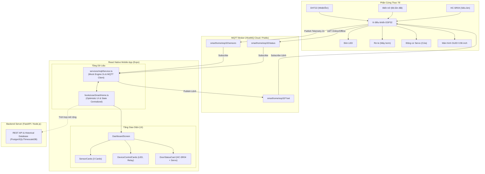

# Smart Home IoT Mobile App (ESP32 & HiveMQ MQTT)

Ứng dụng quản lý nhà thông minh được phát triển bằng **React Native (Expo + TypeScript)**, thiết kế theo chuẩn **Clean Architecture** và phong cách **Modern Smart Home UI** (lấy cảm hứng từ giao diện Clean, bo góc mềm mại, hiển thị trực quan).

---

## 1. Sơ đồ cấu trúc thư mục dự án

```
quanlynhathongminh/
├── app.json                          # Cấu hình Expo Application
├── package.json                      # Dependencies (React Native, Expo, Icons)
├── tsconfig.json                     # Cấu hình TypeScript & Path Alias (@/*)
├── App.tsx                           # Điểm khởi chạy ứng dụng (Root Navigation, Theme Provider)
└── src/
    ├── types/
    │   └── iot.ts                    # Interface/Type chuẩn hóa cho Sensors, Actuators, MQTT
    ├── constants/
    │   ├── theme.ts                  # Design Tokens: Light & Dark Mode, Colors, Radii, Shadows
    │   └── mqttTopics.ts             # Định nghĩa Topic MQTT chuẩn kết nối ESP32 - HiveMQ
    ├── services/
    │   └── mqttService.ts            # Tầng Service: Realistic Mock Engine & HiveMQ Client
    ├── hooks/
    │   └── useSmartHome.ts           # Custom Hook: State Management & Optimistic UI Dispatchers
    ├── components/
    │   ├── HeaderStatus.tsx          # Lời chào, nút Reconnect, Badge đồng bộ OLED (WiFi/MQTT)
    │   ├── SensorCard.tsx            # Grid 3 thẻ cảm biến: Nhiệt độ DHT22, Độ ẩm DHT22, Độ ẩm đất
    │   ├── DeviceControlCard.tsx     # Thẻ công tắc lớn: Đèn LED phát sáng, Rơ-le module (Máy bơm/Quạt)
    │   ├── DoorStatusCard.tsx        # Cửa thông minh: Cảm biến siêu âm HC-SR04 + Động cơ Servo 90°
    │   └── BottomTabBar.tsx          # Thanh điều hướng Tab Bar dưới cùng (Thiết bị, Thống kê, Cài đặt)
    └── screens/
        ├── DashboardScreen.tsx       # Màn hình chính Dashboard tổng hợp
        ├── AnalyticsScreen.tsx       # Màn hình Thống kê & Biểu đồ lịch sử (Sẵn sàng nối Backend)
        └── SettingsScreen.tsx        # Màn hình Cài đặt HiveMQ Broker & Ngưỡng tự động hóa
```

---

## 2. Kiến trúc kết nối & Luồng dữ liệu (Clean Architecture)



---

## 3. Quy chuẩn Topic & Dữ liệu JSON (Payloads)

### A. Telemetry Cảm biến (ESP32 Publish -> `smarthome/esp32/sensors`)
```json
{
  "dht22": {
    "temperature": 27.4,
    "humidity": 62.5
  },
  "soil": {
    "percentage": 78,
    "rawValue": 3196,
    "status": "optimal"
  },
  "ultrasonic": {
    "distanceCm": 118,
    "objectDetected": false
  },
  "timestamp": 1740000000000
}
```

### B. Trạng thái sống & Màn hình OLED (ESP32 Publish -> `smarthome/esp32/status`)
```json
{
  "status": "online",
  "wifiRssi": -58,
  "ip": "192.168.1.188",
  "oled": "WiFi: OK | MQTT: OK"
}
```

### C. Lệnh điều khiển Đèn LED (App Publish -> `smarthome/esp32/led/set`)
```json
{
  "state": "ON",
  "brightness": 80
}
```

### D. Lệnh điều khiển Rơ-le (App Publish -> `smarthome/esp32/relay/set`)
```json
{
  "state": "ON"
}
```

### E. Lệnh điều khiển Cửa / Servo (App Publish -> `smarthome/esp32/door/set`)
```json
{
  "angle": 90,
  "override": true
}
```

---

## 4. Hướng dẫn chạy thử nghiệm ứng dụng (Expo)

1. Cài đặt các thư viện cần thiết:
   ```bash
   npm install
   ```
2. Khởi chạy dự án với Expo:
   ```bash
   npx expo start
   ```
3. Mở ứng dụng bằng **Expo Go** trên điện thoại (quét mã QR) hoặc chạy trực tiếp trên Trình duyệt Web (`w`), Android Emulator (`a`), hoặc iOS Simulator (`i`).

> **Lưu ý:** Ứng dụng đã được tích hợp sẵn **Mock Hardware Simulator** mô phỏng chính xác hành vi phần cứng ESP32: các chỉ số nhiệt độ, độ ẩm và khoảng cách sẽ tự động cập nhật mỗi **2 giây**, khi ấn bật/tắt thiết bị sẽ có hiệu ứng **Optimistic UI** phản hồi ngay lập tức!
